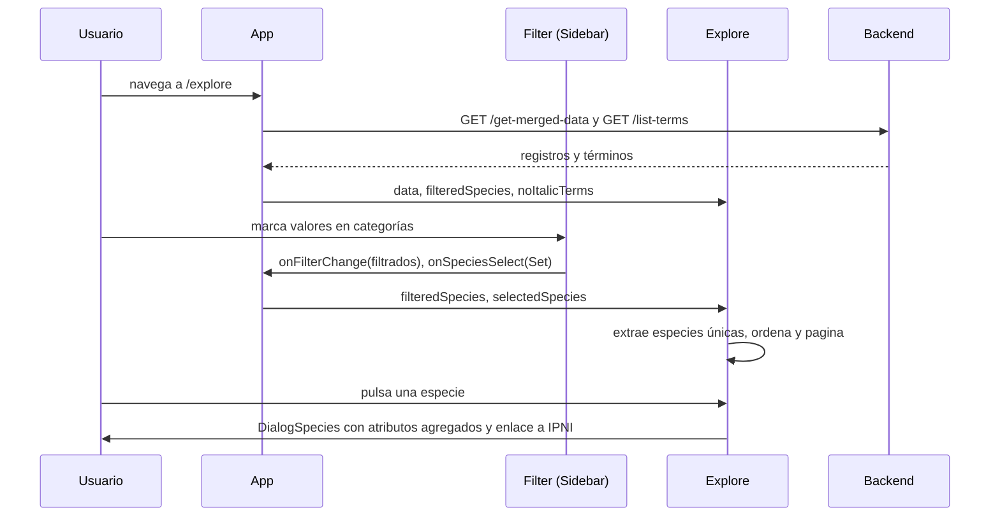

# 01. Arquitectura

## Estructura de carpetas

```
sigmetum-frontend/
├── public/                  # index.html, favicon, manifest, robots.txt
├── src/
│   ├── index.js             # Punto de entrada: ErrorBoundary > BrowserRouter > App
│   ├── App.js               # Layout, rutas y estado global de datos
│   ├── i18n.js              # Configuración de i18next (ES por defecto, EN)
│   ├── index.css            # Directivas de Tailwind y tipografías base
│   ├── App.css              # Solo .App { text-align: center }; existe pero no se importa en ningún sitio (residual)
│   ├── config/
│   │   ├── env.js           # Lectura centralizada de variables VITE_*
│   │   └── assets.js        # Claves de S3 de los recursos estáticos y assetUrl()
│   ├── services/
│   │   ├── api.js           # Cliente HTTP único (fetch + envoltorio { success, data }), 401 con refresco, 503 con reintentos y todas las llamadas a cognito-idp (login SRP, retos, renovación, cierre de sesión)
│   │   ├── srp.js           # Cálculo SRP de Cognito (sin red ni almacenamiento)
│   │   └── session.js       # Almacén de la sesión: tokens de acceso y de refresco (localStorage)
│   ├── hooks/
│   │   ├── useToast.js      # Contexto y hook de los avisos (notifySuccess, notifyError)
│   │   ├── useCognitoLogin.js   # Máquina de estados del acceso (credenciales, contraseña nueva, TOTP)
│   │   ├── useDialog.js     # Estado de los diálogos de aviso/confirmación
│   │   └── useDocumentTitle.js  # Título de la pestaña según la ruta y el idioma
│   ├── utilities/           # Funciones puras y hooks auxiliares
│   ├── languages/{es,en}/translation.json
│   ├── pages/               # Una por ruta
│   └── components/          # Componentes reutilizables
├── tailwind.config.js       # Fuentes Amaranth y Sen, colores de marca (tokens) y espaciado con nombre
├── e2e/ y playwright.config.js  # Suite E2E local de las páginas públicas (`npm run e2e`, fuera de la CI)
├── .env.example             # Plantilla de variables de entorno
└── .claude/                 # Plugins y skills de Claude Code compartidos
```

## Arranque

[src/index.js](../src/index.js) monta la aplicación en `#root` con este árbol:

```
<ErrorBoundary>          ← captura cualquier error de render y muestra "Algo salió mal"
  <BrowserRouter>        ← enrutado por History API
    <App />
```

Antes del render se importa `./i18n`, que inicializa i18next con detección automática del idioma del navegador y mantiene el `lang` de `<html>` igual al idioma mostrado. `BrowserRouter` activa las opciones `future` `v7_startTransition` y `v7_relativeSplatPath` de React Router 6 (así desaparecen sus avisos de consola); las rutas son planas y los enlaces absolutos, así que no cambia ninguna resolución. `App` llama una vez a `useDocumentTitle()` para el `<title>` por ruta (ver [04](04-paginas.md#título-de-página-por-ruta)).

## Layout

`App` pinta siempre la misma estructura, envuelta en `MotionConfig reducedMotion="user"` (las animaciones de `motion` se desactivan si el sistema pide movimiento reducido; B19) y en `ToastProvider` (dos regiones de avisos siempre montadas, `role="status"` y `role="alert"`):

```
[Saltar al contenido]  ← enlace visible solo con foco, hacia #contenido
┌──────────────────────── Header (fijo, h-16) ─────────────────────────┐
│ Logo + SIGMETUM-A      LanguageSwitcher (<select>)       Navbar      │
├──────────┬───────────────────────────────────────────────────────────┤
│ Sidebar  │  <main id="contenido">  ← <Routes> (página activa)         │
│ (desde md│                                                           │
│ a la     │                                                           │
│ izquierda)                                                           │
├──────────┴───────────────────────────────────────────────────────────┤
│ Footer: único <footer> (instituciones, contacto, enlaces, copyright)   │
└──────────────────────────────────────────────────────────────────────┘
CookieBanner (sticky al final de la raíz, hasta que se acepta)
Bajo md, Sidebar es una barra inferior fija (h-nav)
```

La comparación de rutas de `App` y de `Sidebar` usa `normalizePath` (`src/config/routes.js`): quita las barras finales y pasa a minúsculas, como el enrutador, así que `/EXPLORE` y `/Explore` se pintan igual que `/explore` (datos y barra con «Filtros») y `/MANAGE-DATA` igual que `/manage-data`. Solo se compara: la URL del navegador conserva las mayúsculas y no se redirige (un dato del usuario no pasa a `<Navigate>`; S6). Fuera de alcance: `/%45xplore`.

La barra de gestión (`Sidebar`) aparece solo en `/explore` y en las cinco rutas privadas (`/upload-files`, `/manage-data`, `/manage-terms`, `/manage-gallery` y `/manage-recipients`): bajo `md` es una barra inferior fija y desde `md` una columna `sticky` de `w-28` (`md:top-16`, alto `100dvh - 4rem`, hija de la fila flex junto a `main`, ya no `fixed`: no deja hueco bajo ella ni pasa por encima del pie); la raíz reserva solo el espacio de la barra inferior con `pb-nav md:pb-0` (ya no `md:pl-28`) y aparece solo con la sesión confirmada en las rutas privadas (`privateSessionOk`, ver más abajo); el banner de cookies, que es `sticky` y ocupa su sitio en el flujo, se coloca encima de la barra (`bottom-nav md:bottom-0`). Hay un solo `<header>`, dos `<nav>` con nombre (`navbar.label`, «Principal», y `privateNav.label`, «Gestión»), un solo `<main>` y un solo `<footer>`. En las capas, la cabecera es `z-50`, la barra `z-40`, los avisos `z-[55]` y el panel de filtros con su fondo `z-[60]`, por encima de todo.

## Rutas

| Ruta | Página | Acceso | Descripción |
|---|---|---|---|
| `/` | `Home` | Pública | Portada, universidades y entidades colaboradoras, formulario de contacto |
| `/explore` | `Explore` | Pública | Listado paginado de especies características con filtros |
| `/gallery` | `VegetationGallery` | Pública | Galería de fotos de vegetación |
| `/about-us` | `About` | Pública | Propósito, misión y valores del proyecto |
| `/cookies` | `Cookies` | Pública | Política de cookies |
| `/login` | `Login` | Pública | Acceso de administradores: formulario propio (correo y contraseña, con los retos de Cognito) |
| `/upload-files` | `FilesUpload` | **Protegida** | Subida de Excel de datos por provincia |
| `/manage-data` | `DataManagement` | **Protegida** | Consulta, descarga, activación y borrado de versiones |
| `/manage-terms` | `TermsManagement` | **Protegida** | Términos no latinos (excepción de cursiva) |
| `/manage-gallery` | `GalleryManagement` | **Protegida** | Imágenes de la galería |
| `/manage-recipients` | `RecipientsManagement` | **Protegida** | Destinatarios de las dudas de contacto |
| `*` | `NotFound` | Pública | Página 404 |

Las rutas de la SPA están en inglés y en kebab-case (`src/config/routes.js`: `PRIVATE_PATHS` y `LEGACY_REDIRECTS`). Las seis URL españolas antiguas (`/explorar`, `/galeria`, `/sobre-nosotros`, `/cargar-archivos`, `/administrar-datos` y `/administrar-contenido`, esta última hacia `/manage-terms`) son rutas de `App` con `<Navigate replace to={to} />`: el destino sale siempre de la tabla constante, **no se conservan `?` ni `#`** (S4 intacta, ver [seguridad](guias/seguridad.md)) y son redirecciones solo de cliente (no hay 301: ver [para-infra.md](integracion/para-infra.md)). Una ruta privada antigua sin sesión acaba en `/login` y el título de la pestaña ya es el de la ruta nueva. `/` , `/login` y `/cookies` no cambian.

Las rutas protegidas se envuelven en `<ProtectedRoute element={...} />`, que valida la sesión contra `GET /auth` en cada entrada y pinta solo la página. Cada una lleva `key` propia (`upload-files`, `manage-data`, `manage-terms`, `manage-gallery`, `manage-recipients`) y `onStatusChange`: React Router reutilizaba la misma instancia al pasar de una ruta privada a otra y no revalidaba, así que ahora cambiar de ruta privada monta una `ProtectedRoute` nueva y vuelve a llamar a `/auth` (volver a pulsar la ruta actual no revalida). Mientras valida (`checking`) no pinta nada (antes, un spinner «Loading…»; solo un `status` oculto para lectores de pantalla tras «Reintentar»). `App` guarda `privateSessionOk`: pasa a `true` con `ok`, a `false` con `denied` y `unavailable` y al salir de las rutas privadas, y `checking` no lo cambia, de modo que entre dos páginas privadas la barra se queda mientras se revalida y el contenido nuevo no se pinta hasta tener `ok` (decisión del usuario; nada privado, barra incluida, hasta confirmar la sesión en la primera entrada). Si la revalidación entre páginas privadas acaba en `unavailable`, la barra desaparece (ver B47 en [09](09-estado-actual-y-deuda-tecnica.md)). (el botón de cierre de sesión está en la barra de gestión y `ProtectedRoute` lo conserva únicamente en el aviso de servicio no disponible; ver [05-componentes.md](05-componentes.md#protectedroute)).

## Estado global y flujo de datos

No hay Redux ni Context: el estado de datos compartido vive en `App` y se pasa por props.

| Estado en `App` | Tipo | Uso |
|---|---|---|
| `mergedData` | `Array<Registro> \| null` | Todos los registros de todas las provincias (`GET /get-merged-data`). Fuente del explorador |
| `filteredSpecies` | `Array<Registro>` | Resultado de aplicar los filtros a `mergedData` |
| `selectedSpecies` | `Set<string> \| undefined` | Especies marcadas en el filtro "Especies Características" |
| `noItalicTerms` | `Array<{ term }>` | Términos que no se escriben en cursiva (`GET /list-terms`) |
| `filteredData` | `Array<Registro>` | Registros de la versión elegida en "Administrar datos" (los fija `handleFileDropdownSelect`) |
| `privateSessionOk` | `boolean` | `ProtectedRoute` confirmó la sesión en una ruta privada; gobierna la barra de gestión fuera de `/explore` |
| `isLoading`, `exploreError` | `boolean` | Carga y error del explorador. Van como props de `Explore` (`isLoading`, `hasError`), que pinta el estado; `App` ya no sustituye la página por un `LoadSpinner` |
| `filterResetKey` | `number` | `key` del `Filter`: `handleClearFilters` la incrementa y el `Filter` remontado borra su selección (botón «Quitar filtros» de `Explore`) |

El mensaje oculto de «V 1.0.0» ya no es estado de `App`: es un `<details>` dentro de `Footer`.

Un **registro** es una fila del Excel convertida a JSON por el backend. Las claves son los nombres de columna en español (`Provincia`, `Municipio`, `Altitud Media`, `Sector Biogeográfico`, `Piso Bioclimático`, `Ombrotipo`, `Naturaleza del Sustrato`, `Tipo de Serie`, `Serie de Vegetación`, `Vegetación Potencial`, `Especies Características`, `image`...). Algunos valores son arrays, como `Especies Características`.

### Ciclo de vida según la ruta

El `useEffect` de `App` sobre `location.pathname`:

- **`/explore`**: `loadExplore()` activa la carga, limpia filtros y selección y descarga en paralelo `get-merged-data` y `list-terms`; al terminar, la quita. La misma función es el «Reintentar» de `Explore` (`onRetry`): repite las mismas llamadas, sin endpoints nuevos.
- **`/manage-data`**: vacía `filteredData`. Los datos se cargan cuando el usuario elige una versión en `FileDropdown`.
- **Cualquier otra ruta**: libera `mergedData` y todos los filtros para no mantener en memoria el conjunto completo.

Un efecto aparte, sobre `[path, location.hash]`, hace `window.scrollTo(0, 0)` solo si la URL no lleva `#ancla` (con `/#contacto`, el enlace del pie, `Home` lleva su sección a la vista).

### Flujo del explorador



### Flujo de subida de datos (API v2)


Al cancelar (botón "Cancelar" o clic fuera del diálogo), el frontend envía `confirmed: false` para que el backend borre el borrador y detiene la cola de subida. Antes de la corrección A1 no lo hacía (ver [09](09-estado-actual-y-deuda-tecnica.md)).

## Autenticación

Login con formulario propio y SRP (`USER_SRP_AUTH`) contra `cognito-idp` (cliente público, sin secreto). La contraseña solo se usa para el cálculo local y nunca viaja. El almacén de la sesión está en `services/session.js`; todas las peticiones a Cognito, en `services/api.js`.

1. `/login`: `LoginForm` pinta el formulario y `useCognitoLogin` lleva los pasos `credentials`, `newPassword`, `mfaSetup` y `totp`. `api.signIn` hace `InitiateAuth` (`USER_SRP_AUTH`), calcula la prueba con `services/srp.js` y responde `PASSWORD_VERIFIER`.
2. Retos posibles: `NEW_PASSWORD_REQUIRED` (primer acceso: contraseña nueva), `MFA_SETUP` (registro de la aplicación de autenticación: `AssociateSoftwareToken`, `VerifySoftwareToken`) y `SOFTWARE_TOKEN_MFA` (código de seis dígitos). Con el resultado final `api` guarda el token de acceso y el de refresco en `localStorage` (`token` y `refreshToken`; el de identidad nunca) y `LoginForm` navega a `/upload-files`.
3. Las llamadas protegidas añaden `Authorization: Bearer <token de acceso>` (`api.getAuth`, `postAuth`, `postFormAuth`, `deleteAuth`).
4. `401`: una renovación con el token de refresco (`InitiateAuth`, `REFRESH_TOKEN_AUTH`) y un reintento; si Cognito rechaza el refresco, se borra la sesión y se va a `/login`; si no está disponible, se conserva. `503` de autenticación: dos reintentos (1 s y 3 s) sin borrar nada (ver [03-api.md](03-api.md#ante-un-401)).
5. `ProtectedRoute` llama a `GET /auth` al montar cada ruta protegida y, al tener `key` propia, también al cambiar de una ruta privada a otra (en el estado `ok` devuelve solo la página): sin token o con `401` va a `/login`; con cualquier otro error (red, `403`, `5xx`) muestra un aviso de servicio no disponible con botón «Reintentar» y «Cerrar sesión», sin borrar la sesión.
6. Cierre de sesión: botón «Cerrar sesión» de la barra de gestión (`Sidebar` con `showLogout`; `ProtectedRoute` lo conserva solo en el estado `unavailable`) → `api.logout()` borra los tokens, revoca el de refresco (`RevokeToken`, hasta 3 s) y va a `/`.

El flujo completo contra Cognito (SRP, orden de los retos, bloqueo por intentos) no se puede probar en local: **(por confirmar en `dev`)**.

## Recursos estáticos

Logos, banner, imagen de "Sobre nosotros" y glosario PDF se sirven directamente desde S3 o CloudFront con URL pública: `assetUrl(clave) = VITE_S3_URL + '/' + clave`. Las imágenes de la galería llegan como URLs prefirmadas desde `GET /list-images`.
