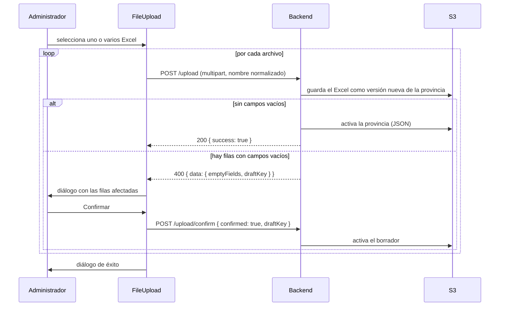

# 01. Arquitectura

## Estructura de carpetas

```
sigmetum-frontend/
├── public/                  # index.html, favicon, manifest, robots.txt
├── src/
│   ├── index.js             # Punto de entrada: ErrorBoundary > BrowserRouter > App
│   ├── App.js               # Layout, rutas y estado global de datos
│   ├── i18n.js              # Configuración de i18next (ES por defecto, EN)
│   ├── index.css            # Directivas de Tailwind y tipografías base
│   ├── App.css              # Solo .App { text-align: center }
│   ├── config/
│   │   ├── env.js           # Lectura centralizada de variables VITE_*
│   │   └── assets.js        # Claves de S3 de los recursos estáticos y assetUrl()
│   ├── services/
│   │   ├── api.js           # Cliente HTTP único (fetch + envoltorio { success, data }), 401 con refresco y 503 con reintentos
│   │   └── session.js       # Sesión de Cognito: tokens (localStorage), PKCE (sessionStorage), login y logout
│   ├── hooks/
│   │   ├── useDialog.js     # Estado de los diálogos de aviso/confirmación
│   │   └── useDocumentTitle.js  # Título de la pestaña según la ruta y el idioma
│   ├── utilities/           # Funciones puras y hooks auxiliares
│   ├── languages/{es,en}/translation.json
│   ├── pages/               # Una por ruta (11)
│   └── components/          # Componentes reutilizables (34)
├── tailwind.config.js       # Fuentes Amaranth (primary) y Sen (secondary)
├── .env.example             # Plantilla de variables de entorno
└── .claude/                 # Plugins y skills de Claude Code compartidos
```

## Arranque

[src/index.js](../src/index.js) monta la aplicación en `#root` con este árbol:

```
<ErrorBoundary>          ← captura cualquier error de render y muestra "Algo salió mal"
  <BrowserRouter>        ← enrutado por History API
    <App />
```

Antes del render se importa `./i18n`, que inicializa i18next con detección automática del idioma del navegador y mantiene el `lang` de `<html>` igual al idioma mostrado. `BrowserRouter` activa las opciones `future` `v7_startTransition` y `v7_relativeSplatPath` de React Router 6 (así desaparecen sus avisos de consola); las rutas son planas y los enlaces absolutos, así que no cambia ninguna resolución. `App` llama una vez a `useDocumentTitle()` para el `<title>` por ruta (ver [04](04-paginas.md#título-de-página-por-ruta)).

## Layout

`App` pinta siempre la misma estructura:

```
┌──────────────────────── Header (fijo, h-16) ─────────────────────────┐
│ Logo + SIGMETUM-A      LanguageSwitcher                  Navbar      │
├──────────┬───────────────────────────────────────────────────────────┤
│ Sidebar  │  <main>  ← <Routes> (página activa)                        │
│ (solo en │                                                           │
│ rutas de │                                                           │
│ datos)   │                                                           │
├──────────┴───────────────────────────────────────────────────────────┤
│ Footer (enlaces + copyright)                             "V 1.0.0"   │
└──────────────────────────────────────────────────────────────────────┘
CookieBanner (fijo abajo, hasta que se acepta)
```

La barra lateral aparece solo en `/explorar`, `/cargar-archivos`, `/administrar-datos` y `/administrar-contenido`.

## Rutas

| Ruta | Página | Acceso | Descripción |
|---|---|---|---|
| `/` | `Home` | Pública | Portada, universidades y entidades colaboradoras, formulario de contacto |
| `/explorar` | `Explore` | Pública | Listado paginado de especies características con filtros |
| `/galeria` | `VegetationGallery` | Pública | Galería de fotos de vegetación |
| `/sobre-nosotros` | `About` | Pública | Propósito, misión y valores del proyecto |
| `/cookies` | `Cookies` | Pública | Política de cookies |
| `/login` | `Login` | Pública | Acceso de administradores: botón que lleva al Hosted UI de Cognito |
| `/auth/callback` | `AuthCallback` | Pública | Vuelta del Hosted UI: canjea el código y lleva a `/cargar-archivos` |
| `/cargar-archivos` | `FilesUpload` | **Protegida** | Subida de Excel de datos por provincia |
| `/administrar-datos` | `DataManagement` | **Protegida** | Consulta, descarga, activación y borrado de versiones |
| `/administrar-contenido` | `ContentManagement` | **Protegida** | Términos no latinos e imágenes de la galería |
| `*` | `NotFound` | Pública | Página 404 |

Las rutas protegidas se envuelven en `<ProtectedRoute element={...} />`, que valida la sesión contra `GET /auth` en cada entrada y pinta el botón de cierre de sesión (ver [05-componentes.md](05-componentes.md#protectedroute)).

## Estado global y flujo de datos

No hay Redux ni Context: el estado de datos compartido vive en `App` y se pasa por props.

| Estado en `App` | Tipo | Uso |
|---|---|---|
| `mergedData` | `Array<Registro> \| null` | Todos los registros de todas las provincias (`GET /get-merged-data`). Fuente del explorador |
| `filteredSpecies` | `Array<Registro>` | Resultado de aplicar los filtros a `mergedData` |
| `selectedSpecies` | `Set<string> \| undefined` | Especies marcadas en el filtro "Especies Características" |
| `noItalicTerms` | `Array<{ term }>` | Términos que no se escriben en cursiva (`GET /list-terms`) |
| `selectedData` | `Array<Registro>` | Registros de la versión elegida en "Administrar datos" |
| `filteredData` | `Array<Registro>` | `selectedData` tras aplicar filtros |
| `isLoading`, `exploreError` | `boolean` | Carga y error del explorador |
| `eeVisible` | `boolean` | Mensaje oculto al pulsar "V 1.0.0" en el pie |

Un **registro** es una fila del Excel convertida a JSON por el backend. Las claves son los nombres de columna en español (`Provincia`, `Municipio`, `Altitud Media`, `Sector Biogeográfico`, `Piso Bioclimático`, `Ombrotipo`, `Naturaleza del Sustrato`, `Tipo de Serie`, `Serie de Vegetación`, `Vegetación Potencial`, `Especies Características`, `image`...). Algunos valores son arrays, como `Especies Características`.

### Ciclo de vida según la ruta

El `useEffect` de `App` sobre `location.pathname`:

- **`/explorar`**: activa el spinner, limpia filtros y selección y descarga en paralelo `get-merged-data` y `list-terms`. Al terminar, quita el spinner.
- **`/administrar-datos`**: vacía `selectedData` y `filteredData`. Los datos se cargan cuando el usuario elige una versión en `FileDropdown`.
- **Cualquier otra ruta**: libera `mergedData` y todos los filtros para no mantener en memoria el conjunto completo.

En todos los casos hace `window.scrollTo(0, 0)`.

### Flujo del explorador


### Flujo de subida de datos (API v2)



Al cancelar (botón "Cancelar" o clic fuera del diálogo), el frontend envía `confirmed: false` para que el backend borre el borrador y detiene la cola de subida. Antes de la corrección A1 no lo hacía (ver [09](09-estado-actual-y-deuda-tecnica.md)).

## Autenticación

Login con el Hosted UI de Cognito (código de autorización con PKCE S256). Todo el almacenamiento de la sesión está en `services/session.js`.

1. `/login`: `LoginForm` muestra un botón que llama a `startLogin()`: genera `code_verifier` y `state` (en `sessionStorage`) y redirige a `<VITE_COGNITO_DOMAIN>/oauth2/authorize`.
2. Cognito vuelve a `/auth/callback`. `AuthCallback` comprueba `state`, canjea el código con `api.exchangeCode` (`POST /oauth2/token`), guarda el token de acceso y el de refresco en `localStorage` (`token` y `refreshToken`) y navega a `/cargar-archivos`. Con `error`, `state` distinto o canje fallido muestra un error con botón de reintento.
3. Las llamadas protegidas añaden `Authorization: Bearer <token de acceso>` (`api.getAuth`, `postAuth`, `postFormAuth`, `deleteAuth`).
4. `401`: una renovación con el token de refresco y un reintento; si falla, se borra la sesión y se va a `/login`. `503` de autenticación: dos reintentos (1 s y 3 s) sin borrar nada (ver [03-api.md](03-api.md#ante-un-401)).
5. `ProtectedRoute` llama a `GET /auth` al montar cada ruta protegida: sin token o con `401` va a `/login`; con cualquier otro error (red, `403`, `5xx`) muestra un aviso de servicio no disponible con botón «Reintentar», sin borrar la sesión.
6. Cierre de sesión: botón de `ProtectedRoute` → `logout()` borra los tokens y redirige a `<VITE_COGNITO_DOMAIN>/logout`.

El flujo completo contra Cognito no se puede probar en local: **(por confirmar en `dev`)**.

## Recursos estáticos

Logos, banner, imagen de "Sobre nosotros" y glosario PDF se sirven directamente desde S3 o CloudFront con URL pública: `assetUrl(clave) = VITE_S3_URL + '/' + clave`. Las imágenes de la galería llegan como URLs prefirmadas desde `GET /list-images`.
